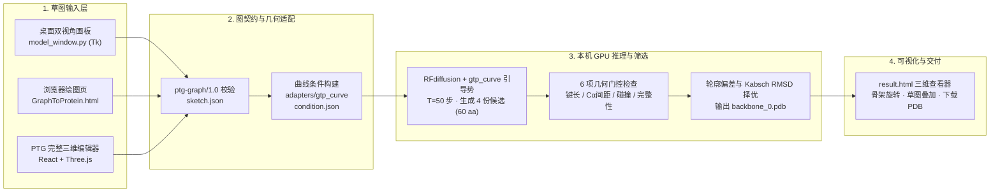

<div align="center">

# 🧬 Protein-Producter

**在 Windows 上绘制一条三维空间折线，驱动本机 RFdiffusion 模型沿草图生成单链蛋白质骨架**

[](https://github.com/Shellmega/Protein-Producter/releases)
[](https://github.com/Shellmega/Protein-Producter)
[-3776AB?style=flat-square&logo=python&logoColor=white)](https://www.python.org/)
[](https://pytorch.org/)
[](LICENSE)

[快速开始](#-快速开始) · [系统架构](#-系统架构) · [启动模式](#-启动模式速查) · [完整说明书](MANUAL.md) · [开发与构建](#-开发与构建)

</div>

---

## ✨ 项目简介

**Protein-Producter** 将三维交互式草图建模与本机 GPU 蛋白质骨架生成整合为一套开箱即用的 Windows 工具链：

* **PhotoToGraph (`PTG`)**：提供三维空间折线编辑器、参考图对齐与标准化的 `ptg-graph/1.0` 图交换契约（`protein_open_chain_v1`）。
* **GraphToProtein (`GTP`)**：将草图折线转化为有序曲线引导势（`gtp_curve`），调用本机 **RFdiffusion** 生成候选骨架，经 6 项严格几何门控筛选出最优结构，并在内置三维查看器中叠加草图展示、支持一键导出 `.pdb` 文件。

<p align="center">
  
  <br />
  <sub>内置 Mol* / Three.js 三维查看器：支持旋转检视生成骨架、叠加原始空间草图与下载 PDB</sub>
</p>

---

## 🏗️ 系统架构



---

## 🚀 快速开始

### 环境要求

| 组件 | 最低要求 | 说明 |
| :--- | :--- | :--- |
| **操作系统** | Windows 10 / 11 (64 位) | 需解压至**可写目录** |
| **Python** | 64 位 Python 3.12（含 Tk） | 推理环境通过 `py -3.12 prepare.py` 自动创建独立 venv |
| **GPU 与驱动** | NVIDIA GPU + 支持 CUDA 12.8 的驱动 | 安装器自动部署 `torch==2.7.1+cu128` |
| **Node.js**（仅开发/工作台） | Node.js ≥ 22.12 | 日常桌面绘图与推理**无需**安装 Node.js |

### 三步运行

1. **下载并解压**
   从 [Releases](https://github.com/Shellmega/Protein-Producter/releases) 下载 `Protein-Producter-v0.1.0-Windows.zip`，完整解压到可写目录。

2. **首次初始化本机 GPU 运行时**
   在解压根目录打开终端执行：
   ```powershell
   py -3.12 prepare.py
   ```
   > [!NOTE]
   > 安装器会自动拉取锁定版本的上游 RFdiffusion 代码、下载约 **484 MB** 的基础权重 `Base_ckpt.pt`、执行 **SHA-256 完整性校验**，并在 `GraphToProtein/local/envs/dsh-gpu` 创建隔离虚拟环境与 PyTorch CUDA 12.8 运行时。

3. **启动并生成蛋白质**
   双击 **`Start.cmd`**，在正面画布点击放置至少 **3 个点**，切到侧面拖动节点调整深度，点击 **「一键生产蛋白质」**。模型生成 4 份候选并完成几何筛选后，会自动弹出三维结果页面。

> [!TIP]
> **仅想先体验绘图与查看界面（不跑模型）？**
> 直接用浏览器打开解压目录中的 `GraphToProtein/GraphToProtein.html` 即可。若是从源码克隆仓库，先执行 `python prepare.py --studio-only` 解压页面。

---

## 🧭 启动模式速查

| 启动方式 | 适用场景 | 说明 |
| :--- | :--- | :--- |
| `Start.cmd` | **日常推荐（桌面模式）** | 无端口原生窗口绘图，调用本机 GPU 推理，结果存入 `GraphToProtein/local/gtp-model-desktop/jobs` |
| `Start.cmd --browser` | 本机浏览器模型模式 | 启动 `127.0.0.1:4178` 本地服务，在浏览器中绘图并提交推理（支持 `--port-offset` 与 `--stop`） |
| `Start.cmd --fixture` | 固定样本联合工作台 | 启动 PTG + 接收端(8078) + 任务端(8079) + 预览端(4178) 联调环境，需 Node.js 与 `jsonschema==4.26.0` |
| 双击 `GraphToProtein.html` | 离线纯前端预览 | 仅支持绘图与查看示例，不执行本地模型推理 |

---

## 📂 仓库目录结构

```text
Protein-Producter/
├── Start.cmd                          # Windows 一键启动入口
├── prepare.py                         # 运行时/权重/上游代码自动安装与 SHA-256 校验脚本
├── rebuild_studio.py                  # 重新构建并压缩单文件绘图页 (studio.html.gz)
├── package_release.py                 # 打包 Windows 发行版 ZIP 与 SHA256SUMS.txt
├── PhotoToGraph/                      # [PTG] 三维草图编辑器与图契约
│   ├── apps/web/                      # React 19 + R3F + Three.js 空间编辑器
│   └── contracts/ptg-graph/v1/        # ptg-graph/1.0 规范、JSON Schema 与测试向量
└── GraphToProtein/                    # [GTP] 曲线适配、推理集成、服务与查看器
    ├── GraphToProtein.html            # 独立打包的绘图与三维查看页
    ├── adapters/gtp_curve/            # 草图 -> 锚点与控制点条件载荷转换
    ├── integrations/rfdiffusion_gtp/  # RFdiffusion 引导势 (gtp_curve) 与 DGL Shim
    ├── experiments/p3/metrics.py      # 几何门控 (geometry_gates) 与 Kabsch RMSD 评估
    ├── services/                      # import_receiver & generation_tasks 后端服务
    ├── apps/import_preview/           # Mol* + Three.js 结果查看器与任务面板
    └── demo/                          # 桌面窗口 (model_window.py) 与本机推理入口 (run.py)
```

---

## 🛠️ 开发与构建

* **独立运行 PTG 三维编辑器**（需 Node.js ≥ 22.12）：
  ```powershell
  cd PhotoToGraph/apps/web
  npm ci
  npm run dev
  ```
* **修改前端后重新打包启动页**：
  分别在 `PhotoToGraph/apps/web` 与 `GraphToProtein/apps/import_preview` 执行 `npm ci`，然后在根目录执行：
  ```powershell
  python rebuild_studio.py
  ```
* **离线环境安装**：
  ```powershell
  py -3.12 prepare.py --wheelhouse offline/wheels --weights offline/Base_ckpt.pt --upstream offline/RFdiffusion
  ```
* **复用已有 GTP 安装目录**：
  启动前设置环境变量 `GTP_PROJECT_DIR` 指向已有 `GraphToProtein` 目录即可跳过重复安装。

---

## 📜 开源许可与上游声明

* 本项目代码遵循 [MIT License](LICENSE)（Copyright © 2026 Yuqi Dai）。
* 上游 RFdiffusion 固定基线为 `RosettaCommons/RFdiffusion@86507b6538f51fce57b5a72477165f03999ed7ae`，基础权重 `Base_ckpt.pt` 与 SE(3)-Transformer 等组件遵循其各自随附许可证。
* 前端与运行时第三方声明详见：
  * `PhotoToGraph/apps/web/THIRD_PARTY_NOTICES.md`
  * `GraphToProtein/apps/import_preview/THIRD_PARTY_NOTICES.md`
  * `GraphToProtein/runtime/upstream-overlay/`
